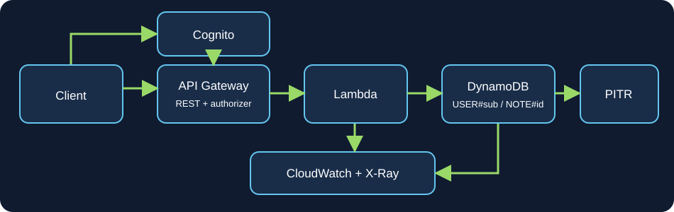
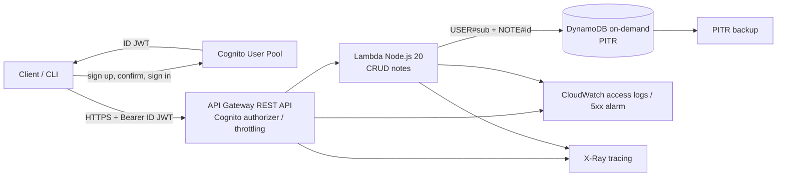

# Serverless product foundation — notes API

A deployable, deliberately small AWS CDK TypeScript proof of concept for a multi-user notes REST API. This is infrastructure and backend code, **not a hosted demo**; no performance, security audit, or cost measurements have been made.



## Architecture



- Cognito self-sign-up with verified email, 12+ character password policy, no client secret for the CLI. The API Gateway Cognito authorizer checks the **ID token**; do not send an access token to these methods.
- REST API exposes `GET/POST /notes` and `GET/PUT/DELETE /notes/{id}`; request body is `{ "title": "...", "content": "..." }`. IDs are UUIDv4, title 1–120 characters, content at most 10,000 characters. `GET /notes` returns up to 50 records plus an optional `nextToken` (use as `?nextToken=...`). Only the caller's `sub` determines the partition key; no user key is accepted from input. Pagination token is not signed but cannot switch partitions; treat it as an opaque cursor, not authorization.
- DynamoDB uses on-demand billing, AWS-managed key encryption, PITR, and composite keys `pk=USER#<JWT sub>`, `sk=NOTE#<UUID>`. The Lambda execution role is granted table-level CRUD and X-Ray permissions; there is no broad DynamoDB policy. Lambda log group has configured retention (7 days dev, 30 days prod), REST API access logs omit headers/body, execution data traces are off. API 5xx and Lambda errors each have an alarm; add your own SNS/incident-action destination before treating these as paging alerts.
- Stage `dev`: 5 req/s, burst 10; teardown destroys table and pool. Stage `prod`: 50 req/s, burst 100, table deletion protection and table/pool retain policies. CloudWatch logs still destroy on teardown. These are **account-level API throttling targets**, not per-user quotas. Cognito self-sign-up may be inappropriate for public production without abuse prevention. Regional WAFv2 is intentionally not created; attach a WebACL to the REST API stage if required and budgeted.

## Prerequisites and deploy

Node.js 22 for building (Lambda runtime is Node.js 20), npm, AWS CLI v2, curl, jq, AWS credentials with CDK bootstrap and deployment permissions, and an email account you can verify. Deploy only into an account/region you control. CDK bootstrap may incur charges (e.g. S3 storage); never check in credentials.

```bash
npm install
npm run lint
npm test
npm run synth -- -c stage=dev
# once per account/region, with authorized credentials:
npx cdk bootstrap aws://$AWS_ACCOUNT_ID/$AWS_REGION
npx cdk deploy ServerlessNotes-dev -c stage=dev
# production is a separate stack, with deletion protection + retain:
npx cdk deploy ServerlessNotes-prod -c stage=prod
```

The stack emits `ApiUrl`, `UserPoolId`, `AppClientId`, `AwsRegion`. CDK uses `CDK_DEFAULT_ACCOUNT`/`CDK_DEFAULT_REGION` from the current AWS profile. Use separate AWS accounts for dev/prod in a real deployment; these stage names alone do not isolate IAM accounts. `npm run synth -- -c stage=prod` also validates the prod template offline.

### Smoke test (creates a disposable Cognito account and note)

```bash
AWS_REGION="<deployed-region>" STAGE=dev EMAIL="<fresh-email-you-control>" ./scripts/smoke.sh
```

This script reads the password interactively without echo, signs up via AWS CLI, pauses for the emailed verification code, signs in using `USER_PASSWORD_AUTH`, then uses `curl` with the Cognito ID JWT to create, list, read, update and delete a note. It uses local temporary credential files with mode 0600, removed on exit; don't paste IDs/tokens into build logs. Running again with the same email will fail sign-up; choose a new address or adapt the script for an existing account. Delete test accounts in Cognito when done. Sign-in uses USER_PASSWORD_AUTH solely for a simple CLI smoke test, not a recommended public browser login flow.

### Teardown

```bash
npx cdk destroy ServerlessNotes-dev -c stage=dev
npx cdk destroy ServerlessNotes-prod -c stage=prod
```

**Important:** prod table has deletion protection and a `RETAIN` policy. Before destroying prod, intentionally disable protection on the existing table if you intend to delete it; retained DynamoDB table and Cognito pool remain after stack deletion and continue to incur charges until manually removed. Review retained resource IDs and backup requirements first. WAF is not included. CDK bootstrap resources persist after stack teardown.

## CI/CD security

`.github/workflows/ci.yml` runs lint, tests and synth on push/PR. Only `workflow_dispatch` can reach the deployment job; set GitHub environments `dev` and `prod` (approval required for prod), environment variable `AWS_REGION`, and environment secret `AWS_DEPLOY_ROLE_ARN`. Configure AWS IAM OIDC trust with strict repository/ref/environment conditions and scope the role to the target account and CDK CloudFormation/asset permissions. No static AWS keys are stored here. GitHub environment approvals are an external repo setting; not provisioned by this template.

## Well-Architected review (design-time, not an audit)

**Operational Excellence**
- Reproducible CDK, unit/assertion tests and explicit manual deployment gate.
- Access logs, tracing and alarms help diagnosis; alarms do not notify until an action is wired in.

**Security**
- Cognito authorizer on every method, input validation, conditional writes and per-caller partitioning in Lambda.
- IAM limits DynamoDB access to one table; it cannot enforce per-user partition isolation with a shared Lambda execution role. Add abuse controls, WAF and stronger auth flow for production.

**Reliability**
- Managed API, Lambda, DynamoDB on-demand and PITR reduce infrastructure maintenance.
- No restore drill, retry policy or explicit multi-region plan is proven; retain policies can complicate teardown.

**Performance Efficiency**
- On-demand throughput and 256 MB Lambda handle variable small-scale traffic without capacity planning.
- Cold starts and query pagination need profiling with actual workload; no latency target has been measured.

**Cost Optimization**
- No idle compute and throttling cap some excess usage; short log retention limits log storage.
- PITR, REST API, alarms and X-Ray introduce charges even at low volume; WAF left optional because it adds fixed cost.

**Sustainability**
- Serverless resource use scales with requests rather than provisioned servers.
- Traces/log volume and retention still use storage/compute; actual carbon impact has not been measured.

## Illustrative monthly cost (not a bill or a benchmark)

For **one** low-traffic stage in a common US region: roughly **$5–$25/month** *as a planning estimate*, assuming ~10k API requests, ~10k DynamoDB read/write operations, 1 GB table storage/PITR, 1 GB log ingestion, 100 monthly active Cognito users, default X-Ray sampling, 2 alarms, no SMS, no WAF, no data egress beyond tiny API responses, and ignoring free-tier credits. Region, Cognito tier/pricing, retries, data size, tracing, logs and orphaned retained resources can change the bill substantially. Check [AWS Pricing Calculator](https://calculator.aws/) and account billing alerts before deployment; add dev and prod separately. AWS WAF would add its own WebACL/rule/request fees.

## Results: to be filled after deployment

No AWS deployment or real smoke test was performed for this repository. Local automated tests and CDK synth verify intended structure and handler behavior only; capture actual outputs, restore test, traffic profile, observed costs and security review after deployment.

## Caveats

- Local `npm audit` reported 14 advisories in the installed dependency tree (including 2 critical in dev tooling and a moderate bundled CDK dependency); review and upgrade dependencies before any production use. This has not been remediated here.
- Lambda Node.js 20 is used to meet the PoC runtime brief, but CDK warns it was deprecated on 2026-04-30; creation is scheduled to be disabled in 2027. Migrate to a supported runtime before long-lived production use.
- Pagination uses an opaque but unsigned cursor; API Gateway Cognito verification and Lambda's fixed `pk` are the tenant boundary, not the cursor. API Gateway REST logging role is an account-level CDK role; review it in shared accounts.
